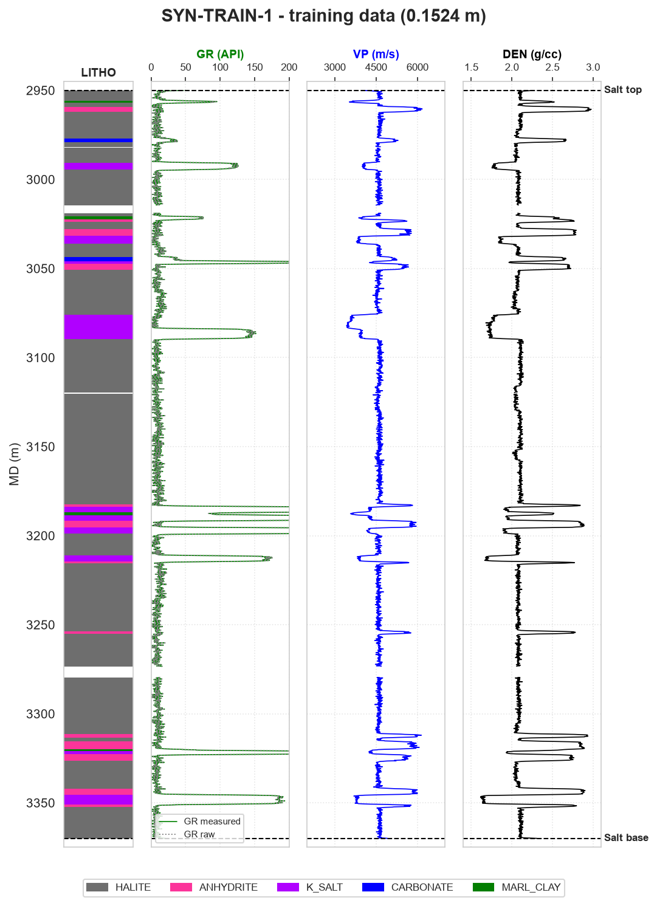
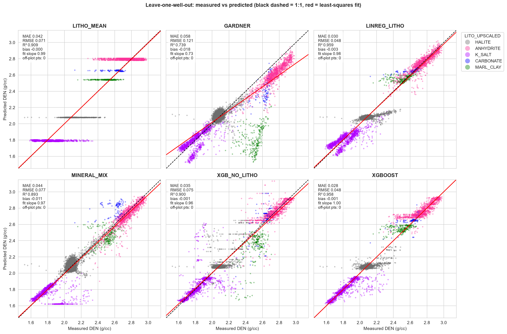
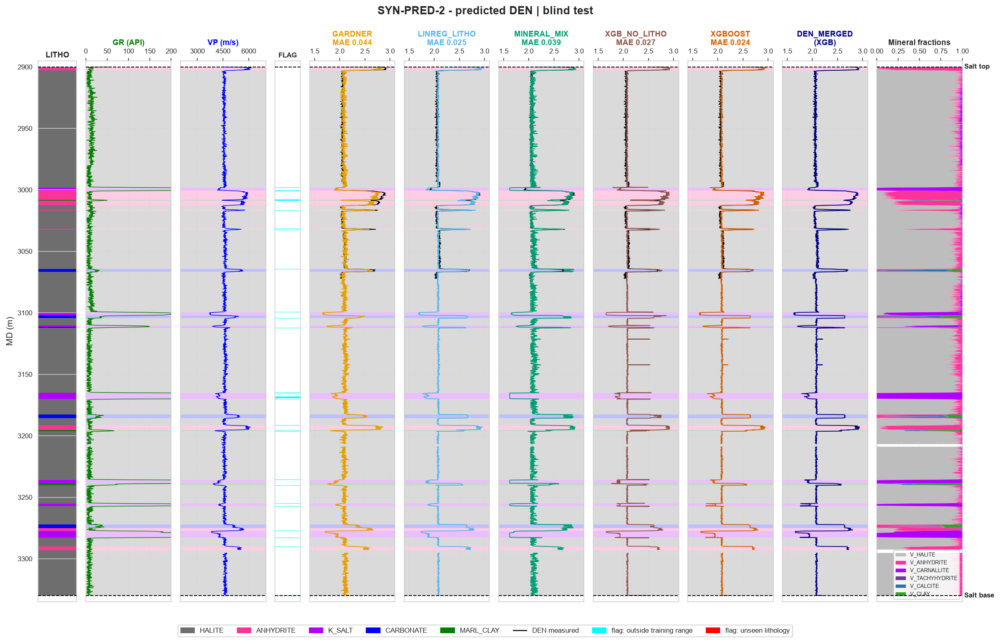
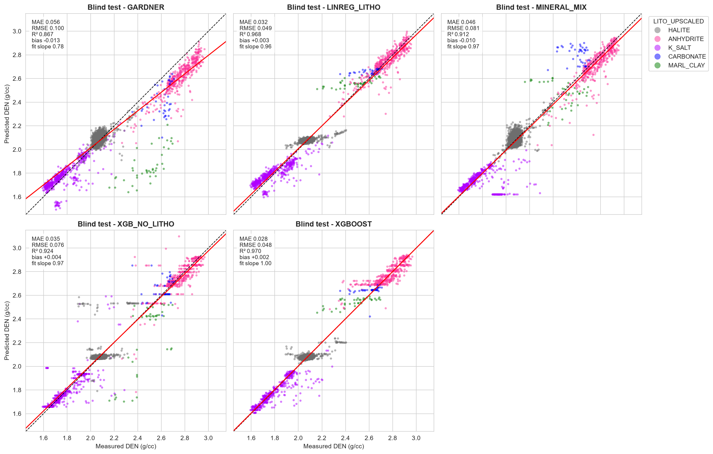
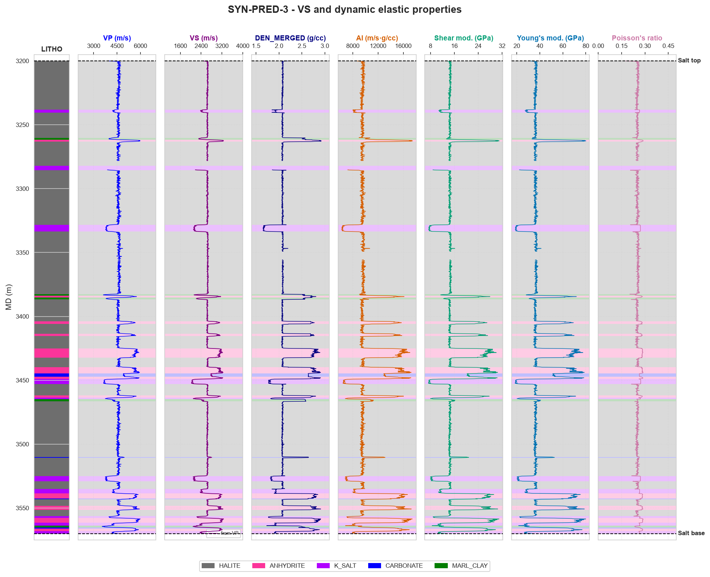

# Bulk Density (RHOB/DEN) Prediction from Well Logs

Machine-learning workflow to predict the bulk density log (DEN / RHOB) from other well logs
(gamma ray, P-wave velocity and lithology), and to fill gaps in wells where density was not
recorded. The model is trained on wells that have a measured density log and then applied to new wells.
The prediction step also fills missing shear velocity (VS) from VP and computes dynamic elastic
properties (acoustic impedance, shear modulus, Young's modulus and Poisson's ratio).

## Overview

| File | Purpose |
|------|---------|
| `train_rhob_model.py` | Script 1: loads the training wells, runs exploratory analysis, compares models and saves the final one |
| `predict_rhob.py` | Script 2: applies the saved model to new wells and exports the results |
| `rhob_common.py` | Shared helpers: LAS reading, resampling, lithology mapping, feature building, VS regression, elastic properties, metrics, plots, LAS export |
| `make_sample_data.py` | Builds the synthetic test wells in `sample_data/` |
| `docs/images/` | Example figures shown in this README |

### Training (`train_rhob_model.py`)

1. Loads the training wells, resamples them to a regular depth step and keeps the interval of interest.
2. Builds per-well statistics tables and exploratory plots (scatter matrices, histograms, crossplots).
3. Compares models with leave-one-well-out (LOWO) cross-validation:
   - XGBoost (GR + VP + lithology)
   - XGBoost without lithology
   - Mean density per lithology
   - Gardner relation (VP to DEN)
   - Linear regression per lithology
   - Mineral mixture model. Evaporites have almost no porosity, so each sample is treated as a mix
     of up to three minerals. The allowed minerals depend on the lithology (`MINERAL_SETS`): for
     example halite, anhydrite and carnallite in the halite and anhydrite intervals. The fractions
     *f*ᵢ come from a bounded weighted least-squares fit of the sonic slowness and the GR:

         DT = Σ fᵢ·DTᵢ     GR = Σ fᵢ·GRᵢ     Σ fᵢ = 1,  0 ≤ fᵢ ≤ 1

     DT mixes linearly as in the Wyllie time-average equation (Wyllie et al., 1956). Density is then
     `DEN = Σ fᵢ·RHOBᵢ`. The mineral end-members (`MINERALS` in `rhob_common.py`) are approximate
     log values from the Schlumberger *Log Interpretation Charts*. The mineral densities are fitted
     on the training wells, each within ±`MINERAL_MAX_CHANGE` g/cc of its chart value. This is the
     usual linear-equation approach to mineral composition from logs (Doveton, 1994).
4. Refits every model on all training wells and saves them: the two XGBoost models as model files,
   the other models as parameters in the metadata file (`rhob_model_meta.json`), together with the
   LOWO scores. The model used for the final density is chosen in the prediction step.

### Prediction (`predict_rhob.py`)

1. Applies the same preparation used in training to each new well.
2. Predicts DEN and flags samples outside the training range or with an unseen lithology.
3. Builds `DEN_MERGED`: measured DEN where it exists, predicted DEN elsewhere. With
   `MERGE_MODEL = 'auto'` the prediction comes from the model with the lowest blind-test MAE on the
   new wells, or from the best LOWO model when no new well has measured DEN. `MERGE_MODEL` can also
   name a fixed model.
4. If a well has some measured DEN, computes blind-test statistics and plots.
5. Fills VS from VP and computes the elastic properties (see below).
6. Exports one LAS file per well, a CSV with all results, and figures.

### VS from VP and elastic properties

VS is read from a shear slowness curve (`DTS`, `DTSM`, ...), converted to m/s, or from a shear
velocity curve (`VS`, ...) when no slowness exists. Where VS is missing, it is estimated with a linear
regression fitted on the samples of the new wells that have both VP and VS:

    VS = slope * VP + intercept      (m/s)

- One equation per lithology when it has at least `VS_MIN_SAMPLES` points (`VS_BY_LITHO = True`),
  otherwise the equation fitted on all lithologies.
- Measured VS outside `VS_VALID_RANGE` is discarded.
- If no well has measured VS, the Castagna (1985) mudrock line is used, with a warning. It is not
  calibrated for evaporites.
- `VS_MERGED` = measured VS where it exists, regression VS elsewhere (`VS_SOURCE`: 1 = measured,
  2 = from VP).

The dynamic elastic properties are then computed from VP, `VS_MERGED` and `DEN_MERGED`
(density ρ in kg/m³):

| Property | Column / LAS curve | Formula | Unit |
|----------|--------------------|---------|------|
| Acoustic impedance | `AI` / `AI` | ρ·VP (density in g/cc) | m/s·g/cc |
| Shear modulus | `SHEAR_MOD` / `GMOD` | G = ρ·VS² | GPa |
| Poisson's ratio | `POISSON` / `PR` | ν = (VP² − 2VS²) / (2(VP² − VS²)) | – |
| Young's modulus | `YOUNG_MOD` / `EMOD` | E = 2G(1 + ν) | GPa |
| VP/VS ratio | `VPVS` / `VPVS` | VP / VS | – |

Samples with VS ≥ VP are left empty. Samples with VS > VP/√2 give a negative Poisson's ratio and
are kept, so check them before use. The values are dynamic (from sonic logs). Static moduli for
geomechanics need a separate correlation.

## Requirements

- Python 3.11
- `numpy`, `pandas`, `matplotlib`, `seaborn`, `scikit-learn`, `scipy`
- `xgboost`, `lasio`, `openpyxl`
- `scikit-optimize` (optional; falls back to a randomized search if missing)

Example setup with conda:

```bash
conda create -n rhob python=3.11
conda activate rhob
pip install numpy pandas matplotlib seaborn scikit-learn scipy xgboost lasio scikit-optimize openpyxl
```

## Usage

1. Put the LAS files of the training wells and of the wells to predict in separate folders.
2. Edit the `CONFIG` block at the top of each script:
   - `BASE_DIR`, the LAS input folders and the output folders
   - `TRAIN_WELLS` and the interval markers (`SALT_MARKERS`) for each well
   - Optional settings: valid ranges, normalization, search iterations, plots
   - In `predict_rhob.py`, the VS settings: `VS_BY_LITHO`, `VS_MIN_SAMPLES`, `VS_VALID_RANGE`
3. Run the training script, then the prediction script:

```bash
python train_rhob_model.py
python predict_rhob.py
```

Both scripts can also be run cell by cell in Spyder or VS Code (cells are marked with `# %%`).
`rhob_common.py` must stay in the same folder as the scripts, or be pointed to with `CODE_DIR`.

## Outputs

- `model_output/` (training): saved model, metadata, tables and figures
- `predictions/` (prediction):
  - one LAS per well with the predicted and merged DEN (`DENMERGED`), VS (`VS`, `VSPRED`, `VSMERGED`,
    `VSSRC`) and the elastic properties (`AI`, `GMOD`, `EMOD`, `PR`, `VPVS`); the VS equations are
    written in the `~Other` section
  - `all_wells_DEN_predicted.csv` with every column
  - `prediction_summary.xlsx`, including the sheets `VS_regression`, `VS_fit_check_per_well` and
    `elastic_stats_per_lithology`
  - figures, including `vs_vp_regression.png` (VS vs VP crossplot with the fitted lines) and
    `elastic_<well>.png` (VP, VS, DEN, AI, G, E and Poisson's ratio tracks per well)

## Data

Your own LAS files and the generated outputs are not versioned. `.gitignore` ignores every top-level
folder except `sample_data/` and `docs/`, so any data folder you create in the project stays local.

## Quick test with synthetic data

`sample_data/` holds synthetic evaporite wells made by `make_sample_data.py`. They are not real
data and must not be used for interpretation:

| Folder | Wells | Purpose |
|--------|-------|---------|
| `sample_data/train/` | `SYN-TRAIN-1` to `5` | GR, sonic (DT or VP), shear (DTS or VS), RHOB and LITO code; different sampling steps and mnemonics |
| `sample_data/predict/` | `SYN-PRED-1` | all logs (full blind test) |
| | `SYN-PRED-2` | RHOB only in the upper part, VS missing in the lower part |
| | `SYN-PRED-3` | no RHOB and no shear log (pure prediction, VS from VP) |

`sample_data/sample_config.json` lists the wells and their interval tops and bases.

The `CONFIG` block of both scripts points to these wells by default (`TRAIN_LAS_DIR`, `NEW_LAS_DIR`,
`TRAIN_WELLS`, `SALT_MARKERS`), so after cloning, run the two scripts as they are:

```bash
python train_rhob_model.py
python predict_rhob.py
```

Results go to `model_output/` and `predictions/`. To use your own wells, change the input folder, well
names and markers in `CONFIG`. To rebuild the synthetic wells, run `python make_sample_data.py`.

## Example figures (synthetic data)

These figures come from running both scripts on `sample_data/` with the default `CONFIG`. The wells
are synthetic, so the figures only show what the workflow produces. Do not read them as a measure of
performance on real wells.

### Training

Input logs of a training well: lithology, GR, VP and measured DEN inside the salt interval.



Leave-one-well-out comparison of the models: measured vs predicted DEN, coloured by lithology.



### Prediction

`SYN-PRED-2` has measured DEN only in its upper part. The tracks show each model's prediction against
the measured log (black), the flags, `DEN_MERGED` and the mineral fractions.



### Results

Blind test on the prediction wells that have measured DEN:



`SYN-PRED-3` has no density and no shear log. DEN comes from the model, VS from the VP regression,
and the elastic properties from both:



## References

- Castagna, J. P., Batzle, M. L. and Eastwood, R. L. (1985). Relationships between compressional-wave
  and shear-wave velocities in clastic silicate rocks. *Geophysics*, 50(4), 571–581.
- Doveton, J. H. (1994). *Geologic Log Analysis Using Computer Methods*. AAPG Computer Applications in
  Geology 2.
- Gardner, G. H. F., Gardner, L. W. and Gregory, A. R. (1974). Formation velocity and density: the
  diagnostic basics for stratigraphic traps. *Geophysics*, 39(6), 770–780.
- Schlumberger. *Log Interpretation Charts*.
- Wyllie, M. R. J., Gregory, A. R. and Gardner, L. W. (1956). Elastic wave velocities in heterogeneous
  and porous media. *Geophysics*, 21(1), 41–70.
